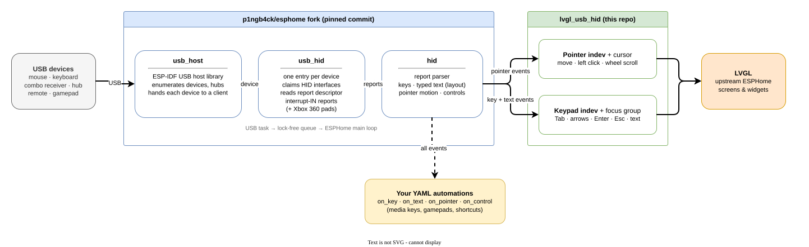

# USB mouse and keyboard for LVGL on the ESP32-P4 (ESPHome)

A USB mouse and keyboard as input for an ESPHome LVGL screen on the ESP32-P4, on **upstream
ESPHome-dev** with ESP-IDF 6.1.

Tested on the **Waveshare ESP32-P4-WIFI6-Touch-LCD-7B** (Type-A USB 2.0 OTG High-Speed port),
ESPHome 2026.11.0-dev, ESP-IDF 6.1.0, LVGL 9.6.

- [What you get](#what-you-get)
- [Supported USB devices](#supported-usb-devices)
- [How it works](#how-it-works)
- [Usage](#usage)
- [Gamepads](#gamepads)
- [Webcams](#webcams)
- [Other USB devices in the fork](#other-usb-devices-in-the-fork)
- [Troubleshooting](#troubleshooting)
- [Limitations](#limitations)

## What you get

- **Mouse:** a cursor (white dot) on top of everything. The left button taps, the scroll wheel
  scrolls whatever is under the cursor, and the cursor hides after `hide_after` without motion.
- **Keyboard:** Tab / Shift+Tab and the arrow keys move the focus over the widgets that have an
  action, Enter presses, Esc is back, and typed text (printable ASCII) goes into a focused text
  area. Arrows go to the widget itself while it is in edit mode (a slider after Enter).
- Mouse and keyboard activity counts as a touch for LVGL inactivity (screen savers, night mode).
- Several devices at once (a combo receiver, or a hub with `enable_hubs: true`).
- Every key, button and control is also available to ESPHome automations through `usb_hid`
  (`on_key`, `on_text`, `on_pointer`, `on_control`), including devices LVGL does not use, such
  as media keys, remotes and gamepads.

## Supported USB devices

Any device goes in the board's Type-A port, directly or through a hub. "LVGL" means this
component turns it into screen input; "Automations" means `usb_hid` delivers it to your YAML.

| Device | LVGL | Automations | Notes |
|---|---|---|---|
| USB mouse (wired or wireless dongle) | ✅ pointer + cursor | ✅ `on_pointer`, `on_key` | Left button, vertical and horizontal wheel go to LVGL. Right/middle/extra buttons only to automations (`MOUSE_RIGHT`, `MOUSE_MIDDLE`, `BUTTON_4`…). |
| USB keyboard | ✅ keypad + focus | ✅ `on_key`, `on_text` | Any of ~90 keyboard layouts (XKB names: `us`, `nl`, `de`, `de(nodeadkeys)`, …). Num/Caps/Scroll Lock LEDs work. |
| Combo receiver (keyboard + mouse on one dongle, e.g. a Logitech Unifying receiver) | ✅ both | ✅ | One USB device with several HID interfaces (up to 4): **one** `usb_hid` entry covers it. |
| Keyboard with built-in touchpad | ✅ if the touchpad reports as a mouse | ✅ | Most do (relative motion). |
| Media keys, multimedia keyboards, USB remote controls | ❌ | ✅ `on_key` (`VOLUME_UP`, `MEDIA_PLAY_PAUSE`, …) | Consumer page keys. |
| Gamepads and joysticks | ❌ (not yet) | ✅ `on_key` (buttons) and `on_control` (sticks, triggers, D-pad) | See [Gamepads](#gamepads). |
| USB touchscreens, drawing tablets (absolute coordinates) | ❌ | ⚠️ raw values via `on_control` | Only *relative* pointers (mice, touchpads) drive the cursor. |
| Barcode scanners in keyboard mode | ✅ as keyboard | ✅ `on_text` | They are keyboards; pick the layout the scanner is set to. |
| Webcams | ❌ | ❌ | See [Webcams](#webcams). |
| USB hub | – | – | Needs `usb_host: enable_hubs: true` (on in the example). |

"✅" for gamepads, remotes and tablets means the code path exists in the fork; this repo is only
tested with mice and keyboards.

## How it works



<sub>Source: [`docs/architecture.drawio`](docs/architecture.drawio) — open it in [draw.io](https://app.diagrams.net) to edit; the SVG embeds the diagram too.</sub>

| Part | From | Does |
|---|---|---|
| `usb_host` | [p1ngb4ck/esphome](https://github.com/p1ngb4ck/esphome) (`testing_dev`) | ESP-IDF USB host library, hub support, routes each plugged-in device to a client |
| `usb_hid` | same fork | one client per USB device: finds its HID interfaces, fetches each report descriptor, reads the interrupt-IN reports. Also decodes Xbox 360 pads (not HID) |
| `hid` | same fork | parses reports into keys and buttons, typed text (keyboard layout, Shift, AltGr, dead keys), mouse motion and other controls |
| `lvgl_usb_hid` | this repo | turns that into LVGL input devices: a pointer with a cursor and a keypad with a focus group |

### From USB report to event

1. When a device is plugged in, `usb_host` enumerates it and hands it to the first free
   `usb_hid` entry that matches (any HID device, or the one with the configured `vid`/`pid`).
2. `usb_hid` claims each HID interface and fetches its **report descriptor**, which says where
   in a report each key, button and axis sits. Nothing is hard-coded per brand: any device that
   follows the HID standard is understood.
3. Reports arrive on the USB task and are passed through a lock-free queue to the ESPHome main
   loop, so everything after this point (automations, LVGL) runs on the main loop.
4. `hid` sorts every value in a report:
   - **keyboard and consumer keys** → key events `(page, usage, pressed)`, and for keyboard
     keys also the **typed text** after the layout is applied;
   - **mouse**: relative X/Y, wheel, horizontal wheel and buttons 1–8 → one pointer event
     `(dx, dy, wheel, pan, buttons)` per report; the buttons are key events too;
   - **everything else** (stick axes, triggers, hat switch, sliders) → control events
     `(page, usage, value)`.
5. `lvgl_usb_hid` listens to the pointer, key and text events of its `usb_hid` entry.

### Mouse → LVGL pointer

- An LVGL pointer input device is created at boot, starting in the middle of the screen.
- Each pointer event moves the position by `dx`/`dy`, clamped to the screen edges. The left
  button is the LVGL "pressed" state, so a click is a tap and holding it drags (sliders, scrolling
  lists, swipes).
- The cursor is a 14 px white dot with a black border on LVGL's system layer, so it is drawn
  above every screen, popup and the top layer. It stays hidden until the mouse first moves and
  hides again after `hide_after` without motion (or a press).
- The wheel scrolls the nearest scrollable widget under the cursor (the widget itself or one of
  its parents) by 40 px per notch, animated; a horizontal wheel or tilt scrolls sideways.
- Every motion counts as LVGL activity, so `on_idle` screen savers and night modes wake up.

### Keyboard → LVGL keypad

ESPHome's LVGL widgets are in no focus group by default. `lvgl_usb_hid` creates a group and fills
it with every widget that is **clickable and has an event handler** (anything with `on_click`,
`on_value`, `on_press`, …), in screen order, on the active screen and on the top layer. It is
refilled whenever another screen is shown or a popup appears on the top layer.

| Key | LVGL |
|---|---|
| Tab / Shift+Tab | next / previous widget |
| → ↓ / ← ↑ | next / previous widget; in edit mode they go to the widget (slider, roller, dropdown, text area cursor) |
| Enter, keypad Enter | press the focused widget; on a slider or roller it toggles edit mode |
| Esc | `LV_KEY_ESC` (closes a dropdown, "back") |
| Backspace, Delete, Home, End | the matching LVGL keys (text areas) |
| printable characters | typed into the focused text area, using the configured layout |

Keys are queued (32 events) between the USB events and LVGL's read cycle, so a quick press and
release between two LVGL reads is not lost.

### Several devices

- Each `usb_hid` entry handles one USB device. Without `vid`/`pid` an entry takes the next HID
  device that is plugged in; with them it only takes that device. The example has two entries:
  enough for a separate keyboard and mouse on a hub. A combo receiver needs only one.
- Each `lvgl_usb_hid` entry creates its own LVGL pointer and/or keypad for one `usb_hid` entry.
  An entry with `pointer: true` whose device turns out to be a keyboard simply never shows its
  cursor, so the defaults (both on) are fine for "whatever gets plugged in".

### Why not the fork's own LVGL integration

The fork connects HID to LVGL inside its own `lvgl` component (`hid_pointers` / `hid_keyboards`).
Using that would replace upstream's LVGL (version, PPA draw settings). `lvgl_usb_hid` does the
same on top of upstream's `lvgl`. The cursor code is adapted from the fork's
`LVHIDPointerListener`.

`lvgl_usb_hid` also carries a small compatibility fix: the fork's `usb_host` calls
`esp32.add_idf_component(override_path=...)` for its patched `espressif/usb` copy, a parameter
only the fork's `esp32` component has. It is translated to the regular `path=` at validation
time, and skipped automatically once ESPHome supports `override_path` itself.

## Usage

Copy [`example/usb_input.yaml`](example/usb_input.yaml) next to your config and include it as a
package. Your device needs `lvgl` and ESP-IDF 6.1:

```yaml
esp32:
  framework:
    type: esp-idf
    version: 6.1.0

packages:
  usb: !include usb_input.yaml
```

The example pins the fork to a commit, because its `testing_dev` branch changes daily. Upstream
ESPHome-dev (checked 2026-10-16) has `usb_host`, `usb_uart` and `usb_cdc_acm`, but no
`usb_hid` yet.

Options per entry:

```yaml
lvgl_usb_hid:
  - hid_id: usb_input_1   # a usb_hid id (any HIDInput)
    pointer: true         # mouse as LVGL pointer with a cursor (default true)
    keyboard: true        # keyboard as LVGL keypad (default true)
    hide_after: 10s       # hide the cursor after this long without motion (default 10s, 0s = never)
```

Useful `usb_hid` options (from the fork):

```yaml
usb_hid:
  - id: usb_input_1
    layout: nl            # keyboard layout, XKB name; or a base layout with keys of your own
    num_lock: true        # Num Lock on at start
    vid: 0x046D           # optional: only this device (vendor/product id, see the log)
    pid: 0xC52B
    device_name:          # text sensor with the name of the connected device
      name: "USB device 1"
```

### Automations

Keyboard shortcuts, media keys and buttons work without LVGL:

```yaml
usb_hid:
  - id: usb_input_1
    on_key:
      - key: F1
        then:
          - lvgl.page.show: main_page
      - key: VOLUME_UP
        then:
          - logger.log: "volume up"
    on_text:
      - then:
          - logger.log:
              format: "typed %s"
              args: [text.c_str()]
```

`on_key` without `key:` fires for every key, with `key` (name) and `pressed` (bool) as variables.
Keys are named as on Linux without `KEY_` (`ENTER`, `F1`, `A`, `LEFT`), consumer keys by function
(`VOLUME_UP`, `MEDIA_PLAY_PAUSE`), buttons as `BUTTON_1`…`BUTTON_32` (`MOUSE_LEFT`,
`MOUSE_RIGHT`, `MOUSE_MIDDLE` as aliases), and anything else as `page:usage`, e.g. `0x01:0x90`.

## Gamepads

**Yes, for automations; not (yet) for LVGL navigation.** `usb_hid` reads gamepads, but
`lvgl_usb_hid` only maps keyboard keys and mouse motion to LVGL, so a gamepad does not move the
focus or a cursor on its own.

Which gamepads:

| Gamepad | Works | How |
|---|---|---|
| Standard HID gamepads and joysticks (most generic USB pads, many 8BitDo modes, arcade sticks) | ✅ | Read through the report descriptor like any HID device |
| Xbox 360 wired (045E:028E) | ✅ | Not HID; decoded as Linux `xpad` does |
| Xbox 360 wireless receiver for PC (045E:0719) | ✅ | Same, first pad |
| 8BitDo in X-input mode (2DC8:310B) | ✅ | Same |
| Xbox One / Series controllers | ❌ | Use the GIP protocol, which is not implemented |
| PlayStation DualShock 4 / DualSense over USB | ⚠️ likely | They are HID gamepads, but untested here |

What a gamepad delivers:

- **Buttons** → `on_key` as `BUTTON_1`, `BUTTON_2`, … (numbering depends on the pad; turn the
  logger to DEBUG and press each button to see its name). On an Xbox 360 pad: A=`BUTTON_1`,
  B=`BUTTON_2`, X=`BUTTON_3`, Y=`BUTTON_4`, LB=`BUTTON_5`, RB=`BUTTON_6`, Back=`BUTTON_7`,
  Start=`BUTTON_8`, stick clicks `BUTTON_9`/`BUTTON_10`, Guide=`BUTTON_11`.
- **Sticks and triggers** → `on_control` as `AXIS_X`/`AXIS_Y` (left stick), `AXIS_RX`/`AXIS_RY`
  (right stick), `AXIS_Z`/`AXIS_RZ` (triggers), with the raw value.
- **D-pad** → on most HID pads `on_control` as `HAT_SWITCH` (0 = up, clockwise to 7, other
  values = released); on an Xbox 360 pad four keys `0x01:0x90` (up), `0x01:0x91` (down),
  `0x01:0x92` (right), `0x01:0x93` (left).

Example: an Xbox 360 pad flips through the LVGL pages with the D-pad and goes to the main page
with A (`on_key` fires on press and on release, hence the `pressed` check):

```yaml
usb_hid:
  - id: usb_gamepad
    on_key:
      - key: "0x01:0x92"     # D-pad right
        then:
          - if:
              condition:
                lambda: return pressed;
              then:
                - lvgl.page.next:
      - key: "0x01:0x93"     # D-pad left
        then:
          - if:
              condition:
                lambda: return pressed;
              then:
                - lvgl.page.previous:
      - key: BUTTON_1        # A
        then:
          - if:
              condition:
                lambda: return pressed;
              then:
                - lvgl.page.show: main_page
    on_control:              # log sticks, triggers and hat switch to find their names
      - then:
          - logger.log:
              format: "%s = %d"
              args: [control.c_str(), value]
```

Built-in gamepad navigation in `lvgl_usb_hid` (D-pad moves the focus, A presses, B is back, left
stick moves the cursor) would be a small addition on top of the existing key and control
events; it is not there yet.

## Webcams

**Not with this setup.** The fork does contain an experimental `usb_uvc` component: it negotiates
an MJPEG or uncompressed stream with a UVC (standard USB video) camera, streams it over
isochronous transfers and assembles frames in two PSRAM buffers. But it only hands those frames to
C++ code: there is no ESPHome `camera` platform for it, so no camera entity in Home Assistant and
no LVGL image, and it has no tests in the fork. Showing a webcam on the screen would need your own
component that decodes the MJPEG frames (the ESP32-P4 has a hardware JPEG decoder) into an LVGL
canvas or image. It is not part of this repo and has not been tried here.

## Other USB devices in the fork

The same fork has more `usb_host` clients. They are independent of `lvgl_usb_hid` and **not
tested here**; listed so you know what exists:

| Component | For |
|---|---|
| `usb_storage` | USB sticks and card readers (mass storage) |
| `usb_audio` | USB sound cards / headsets: speaker, microphone, media player |
| `usb_uart` | USB–serial adapters (CH34x, CH934x, FTDI, CP210x, PL2303); also upstream |
| `usb_cdc_acm` | CDC-ACM serial devices; also upstream |
| `usb_bluetooth` | USB Bluetooth dongles as HCI controller |
| `usb_uvc` | webcams, see above |

## Troubleshooting

- **Nothing happens:** check the log. With the logger at `DEBUG`, `usb_hid` logs every key and
  button as `[usb_input_1] ENTER pressed`. `No usable HID interface on this device` means the
  device is not HID (or not an Xbox 360 pad); `VID:PID: no driver` means no entry claimed it.
- **Mouse works, keyboard focus is invisible:** your LVGL theme or styles must draw a focus state
  (`LV_STATE_FOCUS_KEY`, e.g. an outline under `focused:` / `focus_key:` styles).
- **A widget cannot be reached with Tab:** it needs an action (`on_click`, `on_value`, …) and must
  be clickable.
- **Wrong characters typed:** set `layout:` on the `usb_hid` entry to your keyboard's layout.
- **Device behind a hub not found:** `enable_hubs: true` must be set; try the device directly in
  the port to rule out the hub, and use a powered hub for several devices.
- **Two devices end up in the "wrong" entry:** pin each `usb_hid` entry to a device with
  `vid`/`pid`; `usb_host` logs them as `046D:C52B …` when a device connects.

## Limitations

- Text into LVGL text areas is printable ASCII only; characters like `é` or `€` reach `on_text`
  but are not typed into the text area.
- Only the left mouse button is used by LVGL.
- One cursor per `lvgl_usb_hid` entry; two mice give two cursors.
- Absolute pointers (USB touchscreens, tablets) and gamepads do not drive LVGL.
- ESP32-P4 only in this repo (the fork's `usb_hid` also builds for the S2 and S3, untested here).

## Credits

- `usb_host`, `usb_hid`, `hid` and the cursor approach: [p1ngb4ck/esphome](https://github.com/p1ngb4ck/esphome).
  The HID report parser there comes from [fsievers22/esphome-ble-remote](https://github.com/fsievers22/esphome-ble-remote).
- USB port: Waveshare [ESP32-P4-WIFI6-Touch-LCD-7B wiki](https://www.waveshare.com/wiki/ESP32-P4-WIFI6-Touch-LCD-7B).
