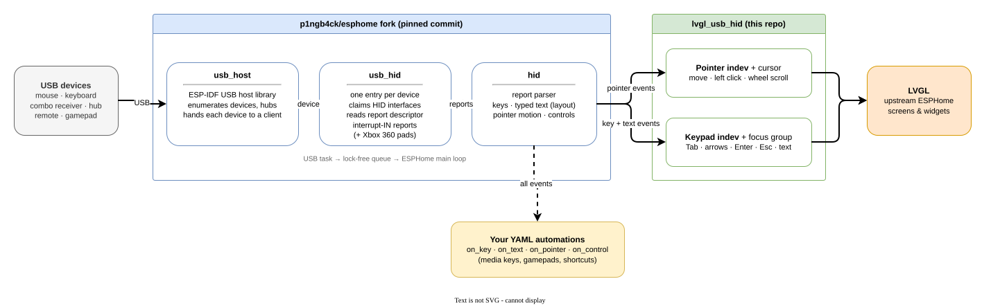

# USB mouse and keyboard for LVGL on the ESP32-P4 (ESPHome)

A USB mouse and keyboard as input for an ESPHome LVGL screen on the ESP32-P4, on **upstream
ESPHome-dev** with ESP-IDF 6.1.

Tested on the **Waveshare ESP32-P4-WIFI6-Touch-LCD-7B** (Type-A USB 2.0 OTG High-Speed port),
ESPHome 2026.11.0-dev (23 Oct 2026), ESP-IDF 6.1.0, LVGL 9.6, with the fork at commit
[`d050f83`](https://github.com/p1ngb4ck/esphome/commit/d050f83b1aec8890d504b9a9e79b8add460fc91a)
(23 Oct 2026).

> **Update 13 Nov 2026 (not yet tested on the hardware):** the fork was reorganised. Its
> `testing_dev` branch is gone; everything is now on [`dev`](https://github.com/p1ngb4ck/esphome/tree/dev),
> built from one repository per topic ([esphome-usb-host](https://github.com/p1ngb4ck/esphome-usb-host),
> [esphome-usb-drivers](https://github.com/p1ngb4ck/esphome-usb-drivers),
> [esphome-hid](https://github.com/p1ngb4ck/esphome-hid),
> [esphome-bluetooth](https://github.com/p1ngb4ck/esphome-bluetooth)). The example now pins `dev` at
> [`9fb8947`](https://github.com/p1ngb4ck/esphome/commit/9fb894738eb7db8cc642f7e08aad1e957cbaea60)
> (3 Nov 2026) and `usb_hid` here is a copy of that commit's with the read-retry change. New in this
> repo: a failing device **behind a hub** no longer resets the whole USB port (that would also drop
> the hub and a Bluetooth dongle on it), and a page on [USB Bluetooth dongles](#usb-bluetooth-dongles).
> Checked so far: `esphome config` and code generation on ESPHome 2026.12.0-dev, and the fork's
> patches apply to `espressif/usb` 1.4.1. **Not yet compiled or run on the Waveshare 7B**: the
> combination below (`d050f83`) is the last one that ran there.
>
> **Update 23 Oct 2026:** the example now pins the fork at `d050f83` and `usb_hid` here is a copy
> of that commit's (with the [read-retry change](#a-device-stops-after-one-read-error-interface-0-stopped-status-1),
> now per device). The big change in the fork since `c550f96` (19 Oct): **one `usb_hid` entry
> serves every HID device that is plugged in** (a keyboard, a mouse, pads, a receiver), each as a
> device of its own; before, an entry took exactly one device. So the example has one `usb_hid`
> and one `lvgl_usb_hid` entry instead of two. A pad's state, driver and details now live on the
> device (`device_input(key)`), not on the entry; keys, text, pointer and controls still reach the
> entry, so `lvgl_usb_hid` and automations are unchanged. Also new: host channels budgeted per
> controller, per-driver blacklists, and the raw report descriptor in the DEBUG log.
> This combination is **compiled and running on the Waveshare 7B** (see the top of the
> [example](example/usb_input.yaml) for what was checked).
>
> Earlier pins: `c550f96` (19 Oct, gamepad layer, ran with a wired Xbox 360 pad), `80faf2e`
> (19 Oct), `caa9733` (13 Oct, the first tested one).

- [What you get](#what-you-get)
- [Supported USB devices](#supported-usb-devices)
- [USB versions, speeds and hubs](#usb-versions-speeds-and-hubs)
- [How it works](#how-it-works)
- [Usage](#usage)
- [Gamepads](#gamepads)
- [USB audio: ESPHome's or the fork's](#usb-audio-esphomes-or-the-forks)
- [Webcams](#webcams)
- [USB Bluetooth dongles](#usb-bluetooth-dongles)
- [Other USB devices in the fork](#other-usb-devices-in-the-fork) (and [USB Ethernet](#usb-ethernet))
- [Troubleshooting](#troubleshooting) (and [a device that stops after a read error](#a-device-stops-after-one-read-error-interface-0-stopped-status-1))
- [Limitations](#limitations)

## What you get

- **Mouse:** a cursor (white dot) on top of everything. The left button taps, the scroll wheel
  scrolls whatever is under the cursor, and the cursor hides after `hide_after` without motion.
- **Keyboard:** Tab / Shift+Tab and the arrow keys move the focus over the widgets that have an
  action, Enter presses, Esc is back, and typed text (printable ASCII) goes into a focused text
  area. Arrows go to the widget itself while it is in edit mode (a slider after Enter).
- Mouse and keyboard activity counts as a touch for LVGL inactivity (screen savers, night mode).
- Several devices at once: a combo receiver, or a hub (see [USB versions, speeds and hubs](#usb-versions-speeds-and-hubs)).
- Every key, button and control is also available to ESPHome automations through `usb_hid`
  (`on_key`, `on_text`, `on_pointer`, `on_control`), including devices LVGL does not use, such
  as media keys, remotes and gamepads.

## Supported USB devices

Any device goes in the board's Type-A port, directly or through a hub. "LVGL" means this
component turns it into screen input; "Automations" means `usb_hid` delivers it to your YAML.

| Device | LVGL | Automations | Notes |
|---|---|---|---|
| USB mouse (wired or wireless dongle) | ✅ pointer + cursor | ✅ `on_pointer`, `on_key` | Left button, vertical and horizontal wheel go to LVGL. Right/middle/extra buttons only to automations (`MOUSE_RIGHT`, `MOUSE_MIDDLE`, `BUTTON_4`…). |
| USB keyboard | ✅ keypad + focus | ✅ `on_key`, `on_text` | Any of ~90 keyboard layouts (XKB names: `us`, `nl`, `de`, `de(nodeadkeys)`, …). Num/Caps/Scroll Lock LEDs work. |
| Combo receiver (keyboard + mouse on one dongle, e.g. a Logitech Unifying or Bolt receiver) | ✅ both | ✅ | One USB device with several HID interfaces (up to 4): **one** `usb_hid` entry covers it. Logitech's own HID++ messages are kept out of the controls. |
| Keyboard with built-in touchpad, separate touchpad | ✅ | ✅ | As mouse motion, with a touch as left button. |
| Media keys, multimedia keyboards, USB remote controls | ❌ | ✅ `on_key` (`VOLUME_UP`, `MEDIA_PLAY_PAUSE`, …) | Consumer page keys. |
| Windows Media Center (MCE / eHome) IR receiver + remote | ⚠️ arrows and OK | ✅ `on_key` | Not HID; decoded as Linux `mceusb` does. The arrows and OK arrive as keyboard keys, so they move the LVGL focus and press; Back is `AC_BACK` (automations only). |
| Gamepads, joysticks, steering wheels | ❌ (not yet) | ✅ `on_key` (buttons, D-pad), `on_control` (sticks, triggers), `sensor` | One layout for every pad. See [Gamepads](#gamepads). |
| USB touchscreens, pens, drawing tablets | ⚠️ as a touchpad | ✅ | The first contact becomes relative motion with the left button held: dragging moves the cursor and presses, a touch does **not** tap where you touch. Motion is in the device's own units, so it can be fast. |
| Barcode scanners in keyboard mode | ✅ as keyboard | ✅ `on_text` | They are keyboards; pick the layout the scanner is set to. |
| USB sound cards, headsets, USB microphones | – | ✅ `microphone`, `speaker` | Through the fork's `usb_audio` in this setup. See [USB audio](#usb-audio-esphomes-or-the-forks). |
| Webcams | ❌ | ❌ picture, ⚠️ microphone | See [Webcams](#webcams). |
| USB Ethernet adapters (CDC-ECM / CDC-NCM) | – | ⚠️ | The fork has `usb_ethernet` since Nov 2026; untested here. See [USB Ethernet](#usb-ethernet). |
| USB Bluetooth dongles | – | ⚠️ | Found and probed by the fork's `usb_bluetooth`; using Bluetooth devices through it needs the fork's Bluetooth components. See [USB Bluetooth dongles](#usb-bluetooth-dongles). |
| USB hub | – | – | Needs `enable_hubs: true`, and `full_speed_only: true` for keyboards, mice and most Bluetooth dongles behind it: see [below](#usb-versions-speeds-and-hubs). |

"✅" for gamepads, remotes, IR receivers and touch screens means the code path exists in the
fork; this repo is only tested with mice and keyboards.

## USB versions, speeds and hubs

USB devices talk at one of three speeds. The version on the box says which standard a device
follows, not how fast it is: a "USB 2.0" keyboard is still a low-speed device.

| Speed | Since | Typical devices |
|---|---|---|
| Low speed, 1.5 Mbit/s | USB 1.0 / 1.1 | most wired mice and keyboards, simple remotes |
| Full speed, 12 Mbit/s | USB 1.1 | wireless receivers (Logitech Unifying and the like), gaming mice, gamepads, most Bluetooth dongles, USB 1.1 hubs |
| High speed, 480 Mbit/s | USB 2.0 | USB 2.0 hubs, webcams, USB sticks, card readers, sound cards |
| SuperSpeed (5 Gbit/s and up) | USB 3.x | not in this port: USB 3 devices fall back to USB 2.0 speeds |

Keyboards, mice and gamepads are always low or full speed; HID never needs more.

The Type-A port of the Waveshare board is the ESP32-P4's **high-speed USB 2.0 controller**.
Plugged in **directly**, a device of any of the three speeds works.

### Hubs: where mixing speeds goes wrong

A USB 2.0 hub on a high-speed port runs at high speed itself. To pass low- and full-speed
traffic on, the hub's *transaction translator* turns it into *split transactions*, and the host
has to support those.

With ESP-IDF 6.1 the USB host library is not part of ESP-IDF itself but the `espressif/usb`
component; the fork uses version **1.4.1** of it, with its own patches. That library has no
split transactions: a low- or full-speed device behind a high-speed hub is refused with
`Connected device is LS, transaction translator (TT) is not supported` in the log. This is
still the case in the newest release (1.6.1, 13 Nov 2026; checked in its `hub.c`, `ext_hub.c` and
docs), where Espressif lists it as a known limitation.

So **a keyboard or mouse behind a USB 2.0 hub is not found by default**, while a high-speed
device (a USB stick) behind the same hub is. The same goes for a **Bluetooth dongle**: nearly all
of them (CSR, Broadcom, Realtek RTL8761) are full-speed devices. Only combined WiFi + Bluetooth
adapters are usually high speed.

The fix is `full_speed_only: true` in `usb_host` (from the fork). The high-speed controller then
ignores the high-speed handshake, so the hub and everything behind it run at full or low speed:
the hub passes full-speed traffic straight on and sends low-speed traffic after a *PRE* packet,
which needs no split transactions. Espressif documents exactly this as the way around the missing
transaction translator (`fsls_only`, added in `espressif/usb` 1.6.0). ESP-IDF 6.1's HAL lacks a
setter that 1.6.0 expects, so the fork backports `fsls_only` into its patched 1.4.1 instead.

```yaml
usb_host:
  enable_hubs: true
  full_speed_only: true   # keyboards, mice and Bluetooth dongles behind a hub (no split transactions in espressif/usb)
```

| Setup | Works | Notes |
|---|---|---|
| keyboard, mouse or gamepad directly in the port | ✅ | any speed |
| combo receiver directly in the port | ✅ | the simplest way to get keyboard + mouse; no hub needed |
| USB 2.0 hub, keyboard/mouse behind it, default settings | ❌ | no split transactions; log says `transaction translator (TT) is not supported` |
| USB 2.0 hub, keyboard/mouse behind it, `full_speed_only: true` | ✅ | the hub runs as a full-speed hub |
| USB 1.1 hub (full speed), keyboard/mouse behind it | ✅ | it is a full-speed hub anyway; `full_speed_only` makes no difference |
| keyboard with a built-in hub (extra USB ports) | ⚠️ | that hub is a USB 2.0 or 1.1 hub like any other: the two rows above apply |
| USB 2.0 hub, only high-speed devices behind it | ✅ | without `full_speed_only` |
| keyboard/mouse **and** a high-speed device (stick, webcam) on one hub | ⚠️ | only with `full_speed_only: true`; the high-speed device then runs at 12 Mbit/s |
| keyboard/mouse **and** a Bluetooth dongle on one USB 2.0 hub | ✅ | with `full_speed_only: true`: all of them are full/low-speed devices, nothing is slowed down |
| hub behind a hub | ✅ | `espressif/usb` allows several hub levels (`CONFIG_USB_HOST_HUB_MULTI_LEVEL`, on by default) |

Good to know:

- Low-speed devices behind a full-speed hub: the controller can put only one PRE-marked
  transaction in a 1 ms frame, so Espressif's driver waits 1 ms between the stages of a control
  transfer. Enumeration takes a little longer; keystrokes and mouse reports are not affected.
  The fork followed its own approach here for a few days (pinned commit `4e93938`) and went back
  to Espressif's on 18 Oct, which is what the commit now pinned does.
- Every device and endpoint takes host channels (16 on the ESP32-P4); a hub with many devices can
  run out, and the next device is then not enumerated.
- `full_speed_only` slows down every high-speed device on the port, not only those behind a hub:
  a USB stick drops from about 480 to 12 Mbit/s (in practice around 1 MB/s), a webcam to small
  MJPEG frames. Audio and HID do not notice.
- Host channels for a hub with a keyboard, a mouse and a Bluetooth dongle: about 2 for the hub, 2–3
  per keyboard or mouse and 4 for the dongle (its two audio endpoints are skipped), so they fit in
  the 16.
- The fork patches hub handling in its copy of `espressif/usb` 1.4.1 (requests of several ports of
  one hub no longer collide, every port is powered before a device is reset, a low-speed device
  that misses SET_ADDRESS is asked again). Espressif's own 1.6.1 fixes two hub crashes (unplugging
  a hub during a control transfer, a leak when a device behind a hub is rejected); the fork's 1.4.1
  copy does not have those two.
- A device behind a hub that keeps failing is stopped on its own; the USB port is not reset (see
  [Troubleshooting](#a-device-stops-after-one-read-error-interface-0-stopped-status-1)).
- The hub rows above follow the `espressif/usb` source and docs and the fork's code; they have
  **not been tested on the hardware with this repo yet**.

### The two USB controllers of the ESP32-P4

The chip has two USB host controllers. The fork can run either or both. On the Waveshare 7B the
[schematic](https://files.waveshare.com/wiki/ESP32-P4-WIFI6-Touch-LCD-7B/ESP32-P4-WIFI6-Touch-LCD-7B.pdf)
shows three USB connectors:

| Connector (wiki item) | Wired to | Controller | 5 V |
|---|---|---|---|
| **Type-A** "USB OTG 2.0 High Speed" (14) | the P4's dedicated USB 2.0 pins (pin 49 DM, pin 50 DP) | high-speed (UTMI PHY): high, full, low speed; the fork's default | **supplied** to the device through a DIO7003HE power switch (2 A version, current limit 2.1–3.5 A) from the board's 5 V |
| **Type-C** "USB1.1 FS Direct Out" (15) | GPIO24 (D−, pin 52) and GPIO25 (D+, pin 53), no chip in between | USB-Serial-JTAG out of reset; the full-speed host controller with `fs_pins: "24_25"` | a power **input** (with a MOSFET power path), not a switched output |
| **Type-C** "USB TO UART" (16) | CH343P USB-to-serial bridge on the ESP's UART | none (the P4 never sees USB here) | power input |

So "for power supply, program flashing, and debugging" on the wiki means: the first Type-C port is
the P4's own USB-Serial-JTAG (logs and flashing straight from the chip), the second one goes
through the CH343P. Only the Type-A port gives power to a device.

The full-speed controller shares two pin pairs with USB-Serial-JTAG: out of reset it uses
GPIO26/27 and USB-Serial-JTAG GPIO24/25. On this board GPIO26/27 go through 0 Ω resistors (R63,
R60) to the RS485 transceiver, and GPIO24/25 are the "USB1.1" Type-C. To use that Type-C as a
second USB host:

```yaml
usb_host:
  dual_host: true      # high-speed (Type-A) and full-speed controller together
  fs_pins: "24_25"     # quoted: unquoted YAML reads 24_25 as the number 2425
```

What that costs and needs:

- USB-Serial-JTAG moves to GPIO26/27, the RS485 lines: logging and flashing over that Type-C
  port stop, and RS485 cannot be used at the same time (logging over the CH343P Type-C, `UART0`,
  keeps working).
- That Type-C port gives no 5 V to a device: use a powered hub, or a cable/adapter that injects
  5 V. A USB-C-to-A OTG adapter alone leaves the device without power.
- Keyboard and mouse can then sit on the full-speed port (directly or behind any hub, without
  `full_speed_only`), while the Type-A port keeps high speed for a USB stick or webcam.
- **Untested** on the hardware; the wiring above is read from the schematic.

### Other `usb_host` options in the fork

| Option | Default | What it does |
|---|---|---|
| `enable_hubs` | `false` | external hubs (`CONFIG_USB_HOST_HUBS_SUPPORTED`) |
| `full_speed_only` | `false` | the high-speed controller as a full/low-speed host (ESP32-P4, ESP32-S31) |
| `dual_host` / `controllers` | high-speed only | `both`, `high_speed` or `full_speed` (ESP32-P4 only) |
| `fs_pins` | `"26_27"` | pin pair of the full-speed controller (ESP32-P4) |
| `max_packet_size` | 512 on the P4, 64 elsewhere | size of each transfer buffer; 512 fits a high-speed bulk packet (USB sticks) |
| `max_transfer_requests` | 16 | transfers each client (each `usb_hid`, `usb_audio`, …) can have in flight (1–32) |
| `mode_switch` | – | devices that start in the wrong mode: `usb_modeswitch`-style bulk messages, a control request, or `hid2hci` for Bluetooth dongles in HID proxy mode. See the fork's [configuration reference](https://github.com/p1ngb4ck/esphome-usb-host/blob/main/CONFIGURATION.md) |

The FIFO division of each controller (how much room received data, bulk and isochronous OUT get)
is chosen per controller by the components that need it (`usb_audio` on a full-speed controller),
not by an option.

Sources: [ESP-USB host guide (ESP32-P4)](https://docs.espressif.com/projects/esp-usb/en/latest/esp32p4/usb_host.html)
(speeds, hubs, transaction translator, `fsls_only`, channels), the
[`espressif/usb` changelog](https://github.com/espressif/esp-usb/blob/master/host/usb/CHANGELOG.md),
[`hub.c`](https://github.com/espressif/esp-usb/blob/master/host/usb/src/hub.c) (the TT check) and
[`hcd_dwc.c`](https://github.com/espressif/esp-usb/blob/master/host/usb/src/hcd_dwc.c) (the 1 ms
low-speed delay), the fork's
[`usb_host`](https://github.com/p1ngb4ck/esphome/tree/80faf2e5523b007878248d108959afaf5f48a5de/esphome/components/usb_host)
(options, `fsls_only` backport, FS pin selection), the
[Waveshare ESP32-P4-WIFI6-Touch-LCD-7B wiki](https://www.waveshare.com/wiki/ESP32-P4-WIFI6-Touch-LCD-7B)
(ports) and [schematic](https://files.waveshare.com/wiki/ESP32-P4-WIFI6-Touch-LCD-7B/ESP32-P4-WIFI6-Touch-LCD-7B.pdf)
(USB wiring, power switches, RS485 on GPIO26/27), and the
[DIO7003 datasheet](https://wmsc.lcsc.com/wmsc/upload/file/pdf/v2/lcsc/2111261830_DIOO-DIO7003LBST5_C2920627.pdf)
(current limits per variant).

## How it works



<sub>Source: [`docs/architecture.drawio`](docs/architecture.drawio) — open it in [draw.io](https://app.diagrams.net) to edit; the SVG embeds the diagram too.</sub>

| Part | From | Does |
|---|---|---|
| `usb_host` | [p1ngb4ck/esphome](https://github.com/p1ngb4ck/esphome) (`dev`) | Espressif's USB host library (`espressif/usb` 1.4.1, patched), hub support, routes each plugged-in device to a client |
| `usb_hid` | same fork | one client per USB device: finds its HID interfaces, fetches each report descriptor, reads the interrupt-IN reports. Also drives devices that are not plain HID: Xbox 360 and Xbox One/Series pads, MCE IR receivers, PlayStation/Switch/Steam pads that need an init |
| `hid` | same fork | parses reports into keys and buttons, typed text (keyboard layout, Shift, AltGr, dead keys), mouse and touch motion, a common gamepad layout and other controls |
| `lvgl_usb_hid` | this repo | turns that into LVGL input devices: a pointer with a cursor and a keypad with a focus group |

### From USB report to event

1. When a device is plugged in, `usb_host` enumerates it and hands it to the first free
   `usb_hid` entry that matches (any HID device, or the one with the configured `vid`/`pid`).
2. `usb_hid` claims each HID interface and fetches its **report descriptor**, which says where
   in a report each key, button and axis sits. Any device that follows the HID standard is
   understood without a driver of its own; only pads and receivers that need an init or speak
   their own protocol have one (see [Gamepads](#gamepads)).
3. Reports arrive on the USB task and are passed through a lock-free queue to the ESPHome main
   loop, so everything after this point (automations, LVGL) runs on the main loop.
4. `hid` sorts every value in a report:
   - **keyboard and consumer keys** → key events `(page, usage, pressed)`, and for keyboard
     keys also the **typed text** after the layout is applied;
   - **mouse**: relative X/Y, wheel, horizontal wheel and buttons 1–8 → one pointer event
     `(dx, dy, wheel, pan, buttons)` per report; the buttons are key events too;
   - **touch screens, pens, touchpads**: the first contact's change in position → the same
     pointer event, with button 1 held while it touches;
   - **gamepads**: buttons and D-pad → key events in one common layout, sticks and triggers →
     control events, normalized;
   - **everything else** (sliders, dials, wheels) → control events `(page, usage, value)`.
5. `lvgl_usb_hid` listens to the pointer, key and text events of its `usb_hid` entry.

### Mouse → LVGL pointer

- An LVGL pointer input device is created at boot, starting in the middle of the screen.
- Each pointer event moves the position by `dx`/`dy`, clamped to the screen edges. The left
  button is the LVGL "pressed" state, so a click is a tap and holding it drags (sliders, scrolling
  lists, swipes).
- The cursor is a 14 px white dot with a black border on LVGL's system layer, so it is drawn
  above every screen, popup and the top layer. It stays hidden until the mouse first moves and
  hides again after `hide_after` without motion (or a press).
- The wheel scrolls the nearest scrollable widget under the cursor (the widget itself or one of
  its parents) by 40 px per notch, animated; a horizontal wheel or tilt scrolls sideways.
- Every motion counts as LVGL activity, so `on_idle` screen savers and night modes wake up.

### Keyboard → LVGL keypad

ESPHome's LVGL widgets are in no focus group by default. `lvgl_usb_hid` creates a group and fills
it with every widget that is **clickable and has an event handler** (anything with `on_click`,
`on_value`, `on_press`, …), in screen order, on the active screen and on the top layer. It is
refilled whenever another screen is shown or a popup appears on the top layer.

| Key | LVGL |
|---|---|
| Tab / Shift+Tab | next / previous widget |
| → ↓ / ← ↑ | next / previous widget; in edit mode they go to the widget (slider, roller, dropdown, text area cursor) |
| Enter, keypad Enter | press the focused widget; on a slider or roller it toggles edit mode |
| Esc | `LV_KEY_ESC` (closes a dropdown, "back") |
| Backspace, Delete, Home, End | the matching LVGL keys (text areas) |
| printable characters | typed into the focused text area, using the configured layout |

Keys are queued (32 events) between the USB events and LVGL's read cycle, so a quick press and
release between two LVGL reads is not lost.

### Several devices

- Since fork `d050f83` **one `usb_hid` entry handles every HID device** that is plugged in, each
  as a device of its own (its own interfaces, report descriptors, keys held and pad). Everything
  they send arrives at the entry, so one entry is enough for a keyboard, a mouse and a pad on a
  hub. `vid`/`pid` on an entry limit it to that device; a second entry is only needed to keep
  devices apart (for example a remote whose keys should go to automations only).
- `device_name` shows the device that connected last. `list_devices()` lists them all, and
  `device_input(key)` gives one device's own input (a pad's sticks, driver, battery).
- Each `lvgl_usb_hid` entry creates one LVGL pointer and/or keypad for one `usb_hid` entry, so all
  mice share one cursor and all keyboards one focus. A device that turns out to be a keyboard
  never shows the cursor, so the defaults (both on) are fine for "whatever gets plugged in".

### Why not the fork's own LVGL integration

The fork connects HID to LVGL inside its own `lvgl` component (`hid_pointers` / `hid_keyboards`).
Using that would replace upstream's LVGL (version, PPA draw settings). `lvgl_usb_hid` does the
same on top of upstream's `lvgl`. The cursor code is adapted from the fork's
`LVHIDPointerListener`.

`lvgl_usb_hid` also carries a small compatibility fix: the fork's `usb_host` calls
`esp32.add_idf_component(override_path=...)` for its patched `espressif/usb` copy, a parameter
only the fork's `esp32` component has. It is translated to the regular `path=` at validation
time, and skipped automatically once ESPHome supports `override_path` itself.

## Usage

Copy [`example/usb_input.yaml`](example/usb_input.yaml) next to your config and include it as a
package. Your device needs `lvgl` and ESP-IDF 6.1:

```yaml
esp32:
  framework:
    type: esp-idf
    version: 6.1.0

packages:
  usb: !include usb_input.yaml
```

The example pins the fork to a commit of its `dev` branch (`9fb8947`, see the note at the top), so
a change in the fork cannot break your build. Upstream ESPHome-dev (checked 2026-11-13,
2026.12.0-dev) has `usb_host`, `usb_uart`, `usb_cdc_acm` and `usb_audio`, but no `usb_hid`, no
`usb_bluetooth` and no `full_speed_only`.

To stay on the combination that ran on the Waveshare 7B, use the fork's commit
`d050f83b1aec8890d504b9a9e79b8add460fc91a` together with this repo at commit `45a1190`
(`ref:` on both sources). That fork commit is no longer on a branch, so GitHub may remove it one day.

Options per entry:

```yaml
lvgl_usb_hid:
  - hid_id: usb_input     # a usb_hid id (any HIDInput)
    pointer: true         # mouse as LVGL pointer with a cursor (default true)
    keyboard: true        # keyboard as LVGL keypad (default true)
    hide_after: 10s       # hide the cursor after this long without motion (default 10s, 0s = never)
```

Useful `usb_hid` options (from the fork):

```yaml
usb_hid:
  - id: usb_input
    layout: nl            # keyboard layout, XKB name; or a base layout with keys of your own
    num_lock: true        # Num Lock on at start
    vid: 0x046D           # optional: only this device (vendor/product id, see the log)
    pid: 0xC52B
    device_name:          # text sensor with the name of the device that connected last
      name: "USB device"
```

### Automations

Keyboard shortcuts, media keys and buttons work without LVGL:

```yaml
usb_hid:
  - id: usb_input
    on_key:
      - key: F1
        then:
          - lvgl.page.show: main_page
      - key: VOLUME_UP
        then:
          - logger.log: "volume up"
    on_text:
      - then:
          - logger.log:
              format: "typed %s"
              args: [text.c_str()]
```

`on_key` without `key:` fires for every key, with `key` (name) and `pressed` (bool) as variables.
Keys are named as on Linux without `KEY_` (`ENTER`, `F1`, `A`, `LEFT`), consumer keys by function
(`VOLUME_UP`, `MEDIA_PLAY_PAUSE`), buttons as `BUTTON_1`…`BUTTON_32` (`MOUSE_LEFT`,
`MOUSE_RIGHT`, `MOUSE_MIDDLE` as aliases), and anything else as `page:usage`, e.g. `0x01:0x90`.

## Gamepads

**Yes, for automations; not (yet) for LVGL navigation.** `usb_hid` reads gamepads, but
`lvgl_usb_hid` only maps keyboard keys and mouse motion to LVGL, so a gamepad does not move the
focus or a cursor on its own.

Since fork commit `4e93938` (17 Oct 2026) every pad is reported in **one common layout**, whatever its brand
or protocol, so an automation written for one pad works with another.

Which gamepads (over USB):

| Gamepad | Works | How |
|---|---|---|
| Standard HID gamepads and joysticks (generic USB pads, 8BitDo in D-input mode, arcade sticks) | ✅ | Read through the report descriptor, mapped the DirectInput way |
| Xbox 360 wired, and pads in X-input mode (8BitDo, many third-party pads) | ✅ | Not HID; decoded as Linux `xpad` does, matched by interface class |
| Xbox 360 wireless receiver for PC (045E:0719) | ✅ | Same, the first pad only |
| Xbox One / Series pads, wired | ✅ | GIP protocol, matched by interface class (every vendor) |
| PlayStation DualShock 3 | ✅ | Needs a USB init, which the driver sends |
| PlayStation DualShock 4, DualSense, DualSense Edge | ✅ | Own driver (Linux `hid-sony` / `hid-playstation`) |
| Nintendo Switch Pro Controller | ✅ | USB handshake, stick calibration, full report mode |
| Steam Controller, Google Stadia | ✅ | Own drivers (lizard mode off on the Steam Controller) |
| Nintendo-layout HID pads (e.g. PowerA) | ✅ | Buttons swapped to the common positions |
| Thrustmaster T150 / T300 / T500 wheels | ✅ | Switched from the generic "FFB wheel" mode to their own |

All but the plain HID pads are new in the pinned fork commit. Tested here (19 Oct 2026, fork
`c550f96`, Waveshare 7B): a **wired Xbox 360 pad**. It reports itself as `045E:028E`, product
string `Controller`, and the fork picks its `Xbox 360` driver (log: `[hid.gamepad] [usb_input_1]
Xbox 360`). Buttons, D-pad, sticks and triggers arrive in the common layout below; see
[Troubleshooting](#a-device-stops-after-one-read-error-interface-0-stopped-status-1) for the one
problem it showed (power). The pad reports its firmware (`1.10` here) and rumble works.
Many third-party pads use the same `045E:028E`, so the ID does not tell an original from a copy.

What a gamepad delivers:

| Control | Event | Names and values |
|---|---|---|
| Face buttons, by **position** | `on_key` | `BUTTON_1` south (A / Cross / B on Nintendo), `BUTTON_2` east, `BUTTON_3` west, `BUTTON_4` north |
| Shoulders, menu buttons | `on_key` | `BUTTON_5` L1/LB, `BUTTON_6` R1/RB, `BUTTON_7` Select/Back/View/Share, `BUTTON_8` Start/Menu/Options, `BUTTON_9` / `BUTTON_10` stick clicks, `BUTTON_11` Home/Guide/PS |
| Extra buttons | `on_key` | `BUTTON_12` / `BUTTON_13` digital L2/R2, `BUTTON_14` Capture/Share, `BUTTON_15` touchpad click, `BUTTON_16` mute, `BUTTON_17`–`BUTTON_20` back paddles |
| D-pad (also hat switches) | `on_key` | `0x01:0x90` up, `0x01:0x91` down, `0x01:0x92` right, `0x01:0x93` left |
| Sticks | `on_control` | `AXIS_X` / `AXIS_Y` left, `AXIS_RX` / `AXIS_RY` right; −32768…32767, Y positive downwards |
| Triggers | `on_control` | `AXIS_Z` left, `AXIS_RZ` right; 0…65535 |

`on_key` fires on press and on release, with `key` and `pressed` as variables; `on_control` gives
`control` (the name) and `value`.

Good to know (seen with the Xbox 360 pad):

- The digital triggers are buttons too (`BUTTON_12` LT, `BUTTON_13` RT): do not give
  `BUTTON_13` a menu action ("exit", "back") if the pad is also used to play.
- The `hid` text sensor of `type: last_key` did not change on gamepad buttons in our test; use
  `on_key` (or a lambda with `is_key_down()`) for those.
- In C++ the whole pad is available for a test screen: `get_gamepad_state()` (axes and
  touchpad), `is_key_down(0x09, n)` for button *n*, `is_key_down(0x01, 0x90…0x93)` for the D-pad,
  `get_gamepad_driver()`, `list_devices()` (the `usb:VID:PID` key and name) and `rumble()`.

Example: a pad flips through the LVGL pages with the D-pad, goes to the main page with the south
button, and shows the left stick as a sensor in Home Assistant:

```yaml
usb_hid:
  - id: usb_gamepad
    on_key:
      - key: "0x01:0x92"     # D-pad right
        then:
          - if:
              condition:
                lambda: return pressed;
              then:
                - lvgl.page.next:
      - key: "0x01:0x93"     # D-pad left
        then:
          - if:
              condition:
                lambda: return pressed;
              then:
                - lvgl.page.previous:
      - key: BUTTON_1        # south: A / Cross
        then:
          - if:
              condition:
                lambda: return pressed;
              then:
                - lvgl.page.show: main_page
                - hid.rumble:
                    id: usb_gamepad
                    strong: 40%
                    weak: 40%
                    duration: 150ms

sensor:
  - platform: hid
    hid_id: usb_gamepad
    control: AXIS_X          # shown as -100..100 (triggers 0..100)
    name: "Gamepad left stick X"
```

Outputs, on pads that have them:

- `hid.rumble` (`strong`, `weak` as percentages, `duration`; 0 ms keeps it on until the next one)
- `hid.set_player_led` (`player` 0–5, 0 is off)
- `hid.set_light_bar` (`red`, `green`, `blue` as percentages; DualShock 4 and DualSense)
- `api_actions: true` on the `usb_hid` entry also offers these as Home Assistant actions
  (`<id>_rumble`, `<id>_set_player_led`, `<id>_set_light_bar`).

Built-in gamepad navigation in `lvgl_usb_hid` (D-pad moves the focus, south presses, east is back,
left stick moves the cursor) would be a small addition on top of these events; it is not there
yet.

## USB audio: ESPHome's or the fork's

Since 18 Oct 2026 ESPHome-dev has its own `usb_audio` component
([#11728](https://github.com/esphome/esphome/pull/11728)). The fork has a different component
with the **same name**. Which one you get depends on what `external_components` loads:

| | ESPHome-dev `usb_audio` | Fork `usb_audio` |
|---|---|---|
| Driver | Espressif's `usb_host_uac` 1.5.0 (its own USB host client) | written in the fork, a client of the fork's `usb_host` |
| Platforms | `microphone`, `speaker` | `microphone`, `speaker`, `media_player`, `audio_dac` (volume) |
| Devices | one `usb_audio` entry, one microphone and one speaker on it; takes the first audio device | several entries (`MULTI_CONF`), each optionally pinned with `vid` / `pid` |
| Formats | 8–96 kHz, 8–32 bit, 1–2 channels | 8–96 kHz, 8–32 bit, microphone up to 8 channels (pick channels), multichannel cards as one stereo pair |
| Extras | volume and mute on the speaker | volume curve, feedback endpoint, per-device quirks |
| Chips | ESP32-P4, S2, S3, S31, H4 | ESP32-P4, S2, S3 |
| Works with this repo's setup | **no** | **yes** |

**On the ESP32-P4 with this repo you need the fork's `usb_audio`.** This setup replaces
ESPHome's `usb_host` with the fork's (for `usb_hid`). ESPHome's `usb_audio` calls
`usb_host.request_periodic_fifo()`, which only ESPHome's own `usb_host` has, so validation stops
with:

```
AttributeError: module 'esphome.components.usb_host' has no attribute 'request_periodic_fifo'
```

Load the fork's `usb_audio` from the same fork commit instead (checked with `esphome config` on
ESPHome-dev of 19 Oct 2026 with fork commit `80faf2e`, not yet compiled or tested on the
hardware):

```yaml
external_components:
  - source:
      type: git
      url: https://github.com/p1ngb4ck/esphome
      ref: 80faf2e5523b007878248d108959afaf5f48a5de
    components: [usb_host, usb_hid, hid, usb_audio]

usb_audio:
  - id: usb_mic_device
    # vid: 0x046D   # optional: only this device
    # pid: 0x0825

microphone:
  - platform: usb_audio
    id: usb_mic
    usb_audio_id: usb_mic_device
    sample_rate: 16000      # what voice_assistant / micro_wake_word want
    num_channels: 1
```

Without `usb_hid` (no keyboard or mouse) ESPHome's own `usb_audio` and `usb_host` work on their
own and need no fork at all.

Good to know:

- Audio uses isochronous transfers. With `full_speed_only: true` (keyboard and mouse behind a
  hub, see [above](#usb-versions-speeds-and-hubs)) a USB 2.0 sound card runs at full speed; for
  16 kHz mono speech that is plenty, high sample rates and many channels may not fit.
- The fork's `usb_host` gives each interface of a device to the component that asks for it, so one
  device can feed several components: the HID buttons of a headset to `usb_hid` and its audio to
  `usb_audio`, or a webcam's microphone to `usb_audio` (see [Webcams](#webcams)).

## Webcams

**Picture: not with this setup.** The fork does contain an experimental `usb_uvc` component: it
negotiates an MJPEG or uncompressed stream with a UVC (standard USB video) camera, streams it over
isochronous transfers and assembles frames in two PSRAM buffers. But it only hands those frames to
C++ code: there is no ESPHome `camera` platform for it, so no camera entity in Home Assistant and
no LVGL image, and nothing else in the fork uses it. Showing a webcam on the screen would need
your own component that decodes the MJPEG frames (the ESP32-P4 has a hardware JPEG decoder) into
an LVGL canvas or image. It is not part of this repo and has not been tried here.

Elsewhere: [anton-malakhov/esphome_webcam](https://github.com/anton-malakhov/esphome_webcam) makes
a USB webcam an ESPHome camera, but only on the ESP32-S2/S3 at USB 1.1 full speed with MJPEG. It
runs its own USB host stack (Espressif's `usb_stream`), so it does not combine with `usb_host` /
`usb_hid`, and its last update (Sep 2025) predates current ESPHome-dev. Espressif's
`usb_host_uvc` shows a USB camera on an ESP32-P4 LCD in plain ESP-IDF, not in ESPHome.

**Microphone: possible, untested.** A webcam with a microphone is one USB device with separate
video and audio interfaces, and the microphone is a normal USB audio (UAC) interface. The fork's
`usb_host` hands the audio interfaces to the fork's `usb_audio`, so the webcam's microphone can be
an ESPHome `microphone` (for example for a voice assistant) even without the picture. Nobody has
reported this working in ESPHome yet; with `full_speed_only: true` the webcam runs at full speed.

## USB Bluetooth dongles

The ESP32-P4 has no radio. On the Waveshare 7B the ESP32-C6 gives it WiFi and Bluetooth LE
(`esp32_hosted`); Bluetooth **Classic** (older keyboards, most gamepads, audio) is not there. A USB
Bluetooth dongle can add it, through the fork's `usb_bluetooth`. Upstream ESPHome-dev has no such
component (checked 13 Nov 2026).

**Status: read from the fork's code and validated with `esphome config`; nothing of this has been
compiled or run on the hardware yet.**

### Three levels

| Level | Config | What you get | On upstream ESPHome-dev |
|---|---|---|---|
| 1. Detect | `usb_bluetooth:` | The dongle is taken by its USB class (any vendor), reset, and its Bluetooth version, address and name are logged. Realtek dongles get their firmware. Nothing uses the radio. | Only `usb_host` and `usb_bluetooth` from the fork: validates and generates code here ([`example/usb_bluetooth.yaml`](example/usb_bluetooth.yaml)) |
| 2. Bluetooth on the dongle | `bluedroid: true`, no `esp32_ble` | ESP-IDF's Bluedroid host runs on the dongle (Classic and LE on its radio) | Validates, but the components that use it (`bt_host`, `bt_hid`, `a2dp_source`) come from the fork and need more of it, see below |
| 3. Split | `bluedroid: true` beside `esp32_ble` | LE on the C6, Classic on the dongle, one Bluedroid | Needs the fork's `esp32_ble` (it waits for the dongle and restarts Bluedroid when it is replugged) |

### What level 2 and 3 need

A Bluetooth keyboard as LVGL input would be `bt_hid` (Classic) or `ble_client_hid` (LE): both are
`hid` inputs, so `lvgl_usb_hid` takes them with `hid_id:` exactly like a `usb_hid` entry. But the
fork's Bluetooth host is not a set of loose components. `bt_host` (pairing, bonding, persistence)
imports the fork's `storage`, and with pairing also its `ble_client`, `ble_client_hid` and
`ble_broadcast`; these rely on hooks in the fork's `esp32_ble`, `ble_client` and `api`. Loaded as
`external_components` they **replace ESPHome's own** `esp32_ble` and `ble_client`, which then stop
following ESPHome-dev (the fork was last merged with it on 1 Nov 2026). Tried here on ESPHome
2026.12.0-dev: `bt_host` alone fails to load (`No module named 'esphome.components.storage'`), and
with `storage` added the next missing piece is `ble_broadcast`.

So for now this repo covers level 1 only. Level 2 and 3 mean running a good part of the fork; if
you want that, the fork's own `dev` branch as the ESPHome version is the more honest setup than
upstream plus a long list of replaced components. See
[esphome-bluetooth](https://github.com/p1ngb4ck/esphome-bluetooth#readme) and the `usb_bluetooth`
part of the fork's [configuration reference](https://github.com/p1ngb4ck/esphome-usb-drivers/blob/main/CONFIGURATION.md).

### Good to know

- **Behind a USB 2.0 hub: `full_speed_only: true`.** Most dongles are full-speed devices and need
  split transactions otherwise (see [Hubs](#hubs-where-mixing-speeds-goes-wrong)). Directly in the
  Type-A port a dongle needs nothing special.
- `usb_bluetooth` needs `max_packet_size` of 256 or more in `usb_host` (an HCI command is one
  control transfer of up to 258 bytes). The ESP32-P4 default is 512, so leave it alone.
- **Realtek** dongles (RTL8761BU and the like) start without firmware: put `rtl8761bu_fw.bin` (and
  the `_config.bin` if the chip has one) from linux-firmware `rtl_bt/` next to the YAML and name
  them with `firmware:` / `firmware_config:`. CSR and Broadcom dongles need none.
- Dongles that start as something else (a "driver CD", or HID proxy mode on some Dell/Logitech/CSR
  ones) are switched by `usb_host`'s `mode_switch`.
- Bluedroid reads its controllers once, when it starts. At level 2 a dongle that is replugged, or
  dropped by a USB port reset, is only used again after a restart of the screen. This is why the
  read-retry change in this repo no longer resets the port for a device behind a hub.
- The dongle draws little power, but a hub with a dongle, a keyboard and a pad adds up: power the
  board from at least 5 V / 2 A (see [Troubleshooting](#a-device-stops-after-one-read-error-interface-0-stopped-status-1)).

## Other USB devices in the fork

The same fork has more `usb_host` clients. They are independent of `lvgl_usb_hid` and **not
tested here**; listed so you know what exists:

| Component | For |
|---|---|
| `usb_storage` | USB sticks and card readers (mass storage) |
| `usb_audio` | USB sound cards / headsets: speaker, microphone, media player; see [USB audio](#usb-audio-esphomes-or-the-forks) |
| `usb_uart` | USB–serial adapters (CH34x, CH934x, FTDI, CP210x, PL2303); also upstream |
| `usb_cdc_acm` | CDC-ACM serial devices; also upstream |
| `usb_bluetooth` | USB Bluetooth dongles as HCI controller, see [USB Bluetooth dongles](#usb-bluetooth-dongles) |
| `usb_ethernet` | CDC-ECM / CDC-NCM network adapters, see [USB Ethernet](#usb-ethernet) |
| `usb_cdrom` | USB optical drives (ISO 9660) |
| `usb_uvc` | webcams (frames only, no camera platform), see [Webcams](#webcams) |

### USB Ethernet

ESPHome-dev itself (checked 13 Nov 2026) cannot use a USB network adapter: its `ethernet`
component only knows RMII PHYs (LAN8720, IP101, …) and SPI chips (W5500, DM9051, CH390, ENC28J60, …).

The fork has a `usb_ethernet` component since November 2026: CDC-ECM and CDC-NCM adapters as a
network interface beside WiFi and Ethernet. It needs the fork's `network` changes as well
(`pr/network-usb-ethernet` in [esphome-network](https://github.com/p1ngb4ck/esphome-network)), so
it is not a drop-in on upstream ESPHome, and it has **not been tried here**. Many cheap adapters
(ASIX AX88179, RTL8153 in its default mode) do not speak ECM or NCM and would not work.

For a wired network on an ESP32-P4 screen, an SPI Ethernet module (W5500, CH390, …) on free GPIOs
is the route ESPHome supports today.

## Troubleshooting

- **Nothing happens:** check the log. With the logger at `VERBOSE` (`DEBUG` up to fork `d050f83`),
  `usb_hid` logs every key and button as `[usb_input] ENTER pressed`. `No usable HID interface on this device` means the
  device is neither HID nor one of the pads and receivers with a driver of their own;
  `VID:PID: no driver` means no entry claimed it.
- **Mouse works, keyboard focus is invisible:** your LVGL theme or styles must draw a focus state
  (`LV_STATE_FOCUS_KEY`, e.g. an outline under `focused:` / `focus_key:` styles).
- **A widget cannot be reached with Tab:** it needs an action (`on_click`, `on_value`, …) and must
  be clickable.
- **Wrong characters typed:** set `layout:` on the `usb_hid` entry to your keyboard's layout.
- **Device behind a hub not found:** set `enable_hubs: true`, and for keyboards, mice and
  gamepads also `full_speed_only: true` (see [USB versions, speeds and hubs](#usb-versions-speeds-and-hubs)).
  Try the device directly in the port to rule out the hub, and use a powered hub for several
  devices. A Bluetooth dongle behind a USB 2.0 hub needs `full_speed_only: true` as well.
- **Keys of one device should not reach LVGL:** give it an entry of its own with `vid`/`pid`
  (and no `lvgl_usb_hid` for that entry); `usb_host` logs devices as `046D:C52B …` when they
  connect.
- **A device stops responding and the log says `Interface 0 stopped (status 1)`:** see below.
- **The screen restarts within seconds after an update and rolls back** (log after the rollback:
  `OTA rollback detected`): on 23 Oct 2026 this was not USB but ESPHome-dev's move to esp_hosted
  3.0.10 (the Wi-Fi link to the C6 on the Waveshare board, esphome PR #21394) while the C6 still
  ran its factory firmware (it reported its version as `unknown`). Fix: update the C6 in two steps
  with `update: platform: esp32_hosted, type: embedded` (the firmware is downloaded at build time,
  so the screen needs no internet): first with `esp32_hosted` taken from ESPHome commit
  `ce83a625c10a9d648f66378fd98984c971b4fa0b` (host 2.12.13) and C6 firmware 2.12.13, then without
  that pin (host 3.0.10) and C6 firmware 3.0.10. The 3.0.10 image calls itself version `1`, so Home
  Assistant does not offer it; start it with `update.perform` and `force_update: true`.

### A device stops after one read error (`Interface 0 stopped (status 1)`)

Seen on 19 Oct 2026 with a wired Xbox 360 pad (`045E:028E`) on the Waveshare 7B: after a while
(once after 8 minutes of play, later after 30 seconds) the pad went dead, and the log had:

```
[W][usb_hid:260][usb_task]: Interface 0 stopped (status 1)
```

Status 1 is `USB_TRANSFER_STATUS_ERROR`: an interrupt-IN transfer failed at the USB level (no
valid answer from the device: a CRC error, a timeout, a glitch on the line). The fork's
`usb_hid` (still in `dev` at `9fb8947` of 3 Nov 2026) then stops reading that interface for good.

What we found by retrying: after the first error, **every** read failed at once (20 retries in
under a second, each with status 1, endpoint halted, flushed and cleared in between). Only
unplugging and plugging in the pad brought it back. So the pad itself stopped answering
properly; it did not disconnect.

**Cause: power.** In this test the board was powered from a laptop's USB port (500–900 mA),
and an Xbox 360 pad draws up to 500 mA by itself, more while it rumbles. A dip of the 5 V on the
Type-A port gives exactly this kind of transaction error. With the board on the laptop's charger
instead, the same pad ran without a single error, rumble included (confirmed 19 Oct 2026). Power
the board from a charger or power bank of at least 5 V / 2 A when a pad is plugged in.

This repo has a copy of the fork's `usb_hid` (from `9fb8947`) with these changes
([`docs/patches/usb_hid-read-retry.patch`](docs/patches/usb_hid-read-retry.patch)):

- On any read error other than "cancelled" or "no device" it halts, flushes and clears the
  endpoint and reads again after 20 ms (log: `Controller: interface 0 read failed (status 1);
  reading again`). This is per device: one failing pad does not touch the keyboard next to it.
- When a device fails more than 5 times in a row without a good read in between, it
  **power-cycles the root port** for 500 ms (`usb_host_lib_set_root_port_power`), so the device
  is enumerated again as if it had been replugged (log: `keeps failing (status 1); resetting the
  USB port (1/5 in 5 min)`). At most 5 resets in 5 minutes; after that it stops until a device is
  plugged in again. Whether the replug brings a stuck pad back has **not been confirmed on the
  hardware yet** (with enough power the error did not come back).
- **Behind a hub the port is not reset** (since 13 Nov 2026): a reset would also drop the hub and
  every other device on it, such as a Bluetooth dongle with its connections. Only the failing
  device stops (log: `behind a hub, so the USB port is not reset. Stopped until it is plugged in
  again`); unplug it and plug it in again.
- Every 5 seconds while reports arrive, an INFO line `N reports in 5 s, M dropped (queue full)`,
  and `No reports for 5 s` once when they stop: handy to see when a device goes quiet.

To use it, take `usb_hid` from this repo and only `usb_host` and `hid` from the fork, as the
[example](example/usb_input.yaml) does:

```yaml
external_components:
  - source:
      type: git
      url: https://github.com/p1ngb4ck/esphome
      ref: 9fb894738eb7db8cc642f7e08aad1e957cbaea60
    components: [usb_host, hid]
  - source:
      type: git
      url: https://github.com/martijnbuts/usb
    components: [lvgl_usb_hid, usb_hid]
```

The copy must match the fork commit of `usb_host` and `hid` (it uses their internals); with
another fork commit, apply the patch to that commit's `usb_hid` instead
(`git apply docs/patches/usb_hid-read-retry.patch` from the fork's root).

## Limitations

- Text into LVGL text areas is printable ASCII only; characters like `é` or `€` reach `on_text`
  but are not typed into the text area.
- Only the left mouse button is used by LVGL.
- One cursor per `lvgl_usb_hid` entry: all mice on that `usb_hid` entry move the same cursor.
- Gamepads do not drive LVGL yet. USB touch screens and tablets move the cursor like a touchpad
  (relative), they do not tap where they are touched.
- The MCE remote's Back key is a consumer key (`AC_BACK`): it reaches automations, not LVGL.
- ESP32-P4 only in this repo (the fork's `usb_hid` also builds for the S2 and S3, untested here).

## Credits

- `usb_host`, `usb_hid`, `hid` and the cursor approach: [p1ngb4ck/esphome](https://github.com/p1ngb4ck/esphome).
  `components/usb_hid` here is a copy of the fork's `usb_hid` (commit `9fb8947`) with the read-retry
  change; it keeps ESPHome's licensing (C++ under GPL-3.0, Python under MIT).
  The HID report parser there comes from [fsievers22/esphome-ble-remote](https://github.com/fsievers22/esphome-ble-remote).
- USB ports: Waveshare [ESP32-P4-WIFI6-Touch-LCD-7B wiki](https://www.waveshare.com/wiki/ESP32-P4-WIFI6-Touch-LCD-7B) and [schematic](https://files.waveshare.com/wiki/ESP32-P4-WIFI6-Touch-LCD-7B/ESP32-P4-WIFI6-Touch-LCD-7B.pdf).
